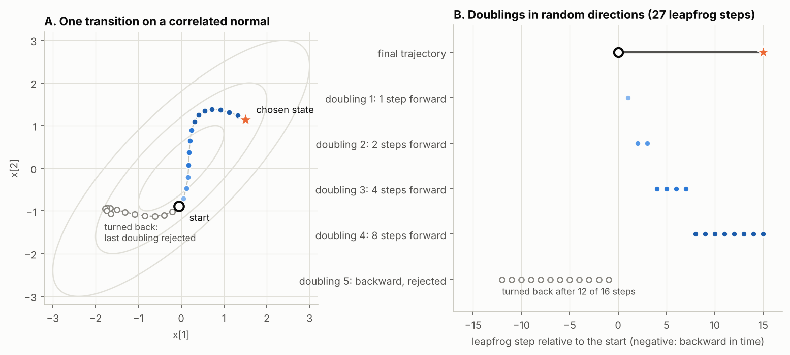
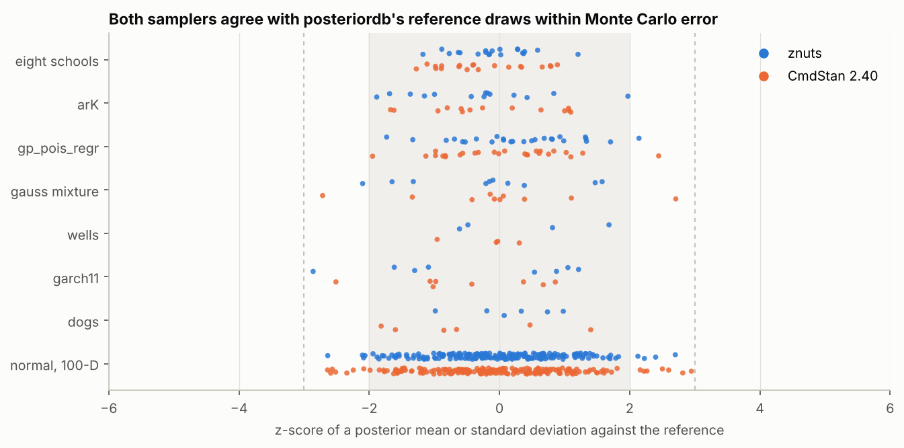
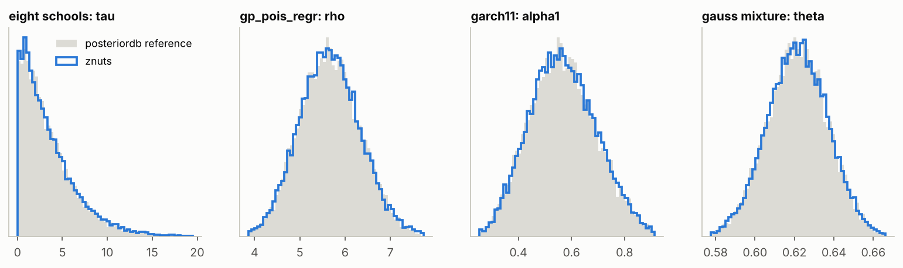
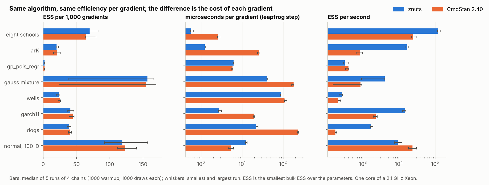

# zig-nuts

The No-U-Turn Sampler (NUTS) in Zig, written to follow Stan's implementation step by step: multinomial sampling along each trajectory, the generalised U-turn criterion with Stan's extra checks across subtree boundaries, dual-averaging step-size adaptation, and a diagonal metric estimated in Stan's warmup windows. Gradients come from forward-mode dual numbers whose derivative part is a `@Vector(n, f64)` sized at compile time, so each arithmetic operation updates the whole gradient with SIMD instructions. There is no autodiff library and no C++.

It was checked against Stan and ArviZ four ways. The log densities and gradients of seven [posteriordb](https://github.com/stan-dev/posteriordb) models agree with CmdStan's. The draws reproduce posteriordb's reference posteriors. The sampler needs about as many gradients per effective draw as CmdStan. And its R-hat and effective sample sizes match ArviZ's to 14 significant digits.



Each transition draws a random momentum and follows Hamilton's equations with leapfrog steps. The trajectory doubles in length each time, forward or backward in time at random (panel B). It stops when its two ends start moving toward each other (a U-turn), or when a new doubling contains a U-turn of its own. In that case the doubling is thrown away, as with the grey states here. The next state is drawn from the trajectory with probability proportional to exp(−H), with a bias toward the newest doubling, which moves the chain further.

## Results

| Claim | Evidence | Grade |
|---|---|---|
| Computes the same posteriors as the Stan programs | Seven posteriordb models translated by hand from Stan to Zig. At 20 random points per model, every gradient component agrees with CmdStan 2.40's `log_prob` to within 3.1×10⁻¹⁰ of 1 + its size. The log densities differ by a constant (Stan keeps a few constant terms that znuts drops), which varies by less than 10⁻⁷ across the points | proven by script (`scripts/stan_logprob.py`, needs CmdStan) |
| Draws reproduce posteriordb's reference posteriors | 88 z-scores (the mean and standard deviation of every reference parameter, from 20 chains). All lie within ±2.9, and 3 lie outside ±2, against about 4 expected by chance; they have mean −0.02 and spread 0.97. CmdStan's draws, run the same way as a control: all within ±2.8, 4 outside ±2. CI repeats the check with 4 chains and fails above 5 | proven (statistical test, runs in CI) |
| It is Stan's algorithm | On each of the 8 targets in the speed figure, znuts's effective draws per gradient are 0.89 to 1.08 times CmdStan's (medians of 5 runs), and a bootstrap 90% interval for every one of these ratios includes 1. The number of leapfrog steps per draw and the adapted step size are within 7% of CmdStan's | measured |
| Diagnostics match ArviZ | Rank-normalised split R-hat, bulk ESS and tail ESS agree with ArviZ (arviz-stats 1.3.3) for every parameter of every model, to a relative difference of 10⁻¹⁴ or less | proven by test (runs in CI) |
| Faster than CmdStan on most of the published programs | Per gradient, 4.6 to 21 times faster on five of the seven posteriordb programs, 1.2 times faster on wells and 5% slower on gp_pois_regr | measured, one machine |
| Slower when Stan's strengths apply | 2.4 times slower on a 100-dimensional normal, where every forward-mode operation carries 100 partial derivatives. When dogs and wells are rewritten with Stan's vectorised `bernoulli_logit_glm`, CmdStan is 2.6 and 3.1 times faster than znuts | measured, one machine |
| Fails where Stan fails | On Neal's funnel in centred form, both samplers report divergent transitions and R-hat above 1.01, and both get the wrong spread for the funnel's scale parameter | measured |

## How it works

### Gradients from dual numbers

A `Dual(n)` is a value and its gradient with respect to the `n` parameters:

```zig
pub fn Dual(comptime n: usize) type {
    return struct {
        val: f64,
        grad: @Vector(n, f64),

        pub inline fn mul(a: Self, b: Self) Self {
            return .{ .val = a.val * b.val, .grad = a.grad * sp(b.val) + b.grad * sp(a.val) };
        }
        // add, div, exp, log, logSumExp, log1mInvLogit, ...
    };
}
```

The model's log density is evaluated once on `n` dual numbers, the i-th seeded with the i-th unit vector. The result's `grad` is the full gradient. Each operation costs `n` lanes of vector arithmetic, so one gradient costs about `n` times one evaluation. Reverse mode, as in Stan, costs a small constant multiple of one evaluation whatever `n` is, but it records every operation on a tape and replays it backward. For models with tens of parameters and scalar code, forward mode skips that bookkeeping. With 100 parameters it does 100 times the arithmetic. The speed results show both effects.

The functions with numerical traps compute value and derivative together. `logInvLogit(x)` (that is, log(1/(1+e⁻ˣ))) and `logSumExp(a, b)` each use one exponential and one `log1p`, stay finite for any input and lose no precision in the tails.

### Models

Each model is a Zig struct whose `logDensity` is generic over the scalar type. It is called with `Dual(dim)` to get a gradient, and with a plain `Real` for values alone. Parameters live on the unconstrained scale, as in Stan:

- a positive parameter is `exp(u)`;
- a probability is `inv_logit(u)`;
- an ordered pair is `(u₁, u₁ + exp(u₂))`;
- GARCH's `beta1 < 1 − alpha1` is `(1 − alpha1) · inv_logit(u)`.

Each transform adds its log Jacobian to the density. Terms that do not depend on the parameters are dropped, as Stan's `~` statements drop them. Quantities that depend only on data stay plain `f64`, such as the dogs model's counts of earlier shocks and avoidances. Part of the eight-schools model:

```zig
pub fn logDensity(m: *const EightSchools, comptime S: type, x: *const [dim]S) S {
    const mu = x[J];
    const tau = x[J + 1].exp();
    var lp = x[J + 1]; // log Jacobian of tau = exp(u)
    for (0..J) |j| {
        lp = lp.sub(x[j].square().scale(0.5)); // theta_trans ~ normal(0, 1)
        const z = x[j].mul(tau).add(mu).addC(-m.y[j]).scale(1 / m.sigma[j]);
        lp = lp.sub(z.square().scale(0.5)); // y ~ normal(theta, sigma)
    }
    ...
```

The parameter count is a compile-time constant because it sets the vector width. The sampler is generic over the model type, so every model gets its own specialised sampler. The posteriordb data files are embedded in the binary.

### The sampler

`src/nuts.zig` follows `stan/mcmc/hmc/nuts/base_nuts.hpp` from Stan 2.26 and later:

- **Trajectory.** The recursive tree is built as in Stan. Within a subtree, the state is drawn in proportion to the weights exp(H₀ − H). Between the old trajectory and each new doubling, the newer half is favoured (biased progressive sampling).
- **U-turn criterion.** It uses sharp momenta, M⁻¹p. It is checked across each merged subtree, and also across the boundary between the two halves (the extra checks added in Stan 2.26).
- **Divergence.** A step whose energy error exceeds 1000 is divergent, and that subtree is rejected.
- **Statistics.** The acceptance statistic averages min(1, exp(H₀ − H)) over every leapfrog step, including those in rejected subtrees.
- **Warmup.** Stan's defaults throughout:
  - dual averaging of log step size toward a mean acceptance statistic of 0.8, with γ = 0.05, κ = 0.75 and t₀ = 10;
  - a diagonal inverse metric from Welford variances in windows of 25, 50, 100, 200 and 500 draws, between a 75-draw initial buffer and a 50-draw terminal buffer;
  - each metric estimate shrunk toward 10⁻³ as Stan does;
  - at the end of each window, Stan's step-size heuristic, which doubles or halves the step until one step's acceptance probability crosses 0.8;
  - initial values uniform in (−2, 2) on the unconstrained scale.

One difference from Stan: a state carries its gradient, so the next transition starts without evaluating it again. CmdStan recomputes it at the start of every transition, which costs one extra gradient per draw.

### Diagnostics

`src/diagnostics.zig` implements the rank-normalised diagnostics of Vehtari, Gelman, Simpson, Carpenter and Bürkner (2021), as ArviZ defines them:

- **R-hat.** Split chains, ranks over all draws with ties averaged, and normal scores Φ⁻¹((r − 3/8)/(S + 1/4)). R-hat is the larger of the bulk value and the value for folded draws |x − median|.
- **Effective sample size.** Geyer's initial monotone sequence on the averaged autocovariances.
- **Tail ESS.** The smaller ESS of the indicators x ≤ q₀.₀₅ and x ≤ q₀.₉₅.

The normal quantile is Wichura's AS 241 algorithm.

## Validation



posteriordb's reference posteriors come from 10 long Stan chains, thinned to 10,000 draws. For each parameter, the z-score divides the difference between znuts's estimate and the reference by their combined Monte Carlo standard error (ArviZ's `mcse_mean` and `mcse_sd`). If znuts samples the right distribution, the z-scores behave like draws from a standard normal, and they do. The 100-dimensional normal is checked against its exact moments.



Two things went wrong in the runs, and both happened to Stan as well:

- **The mixture's local mode.** The Gaussian mixture has a local mode, with both means together and one wide component, where the log density is about 450 lower. Of 20 chains, one znuts chain spent its first 484 warmup iterations there and one CmdStan chain its first 778 (rerun with warmup draws saved). Both escaped, but they left warmup with step sizes of 0.008 and 0.002 instead of about 0.6, and took 56 and 100 leapfrog steps per draw instead of 6. This is why the mixture's whiskers in the speed figure are long. The draws themselves were correct.
- **The funnel.** Neal's funnel in centred form (v ~ normal(0, 3), xᵢ ~ normal(0, exp(v/2))) cannot be sampled well with one step size. Both samplers' summaries say so: divergent transitions, R-hat up to 1.45 for znuts and 1.24 for CmdStan, and bulk ESS below 125. Both get the scale parameter's standard deviation wrong. The true value is 3; znuts gives 2.37 and CmdStan 2.32. No sampler change fixes this; the non-centred parameterisation does.

## Speed



| Model | Parameters | µs per gradient, znuts | µs per gradient, CmdStan | znuts faster by | ESS/s, znuts | ESS/s, CmdStan |
|---|---:|---:|---:|---:|---:|---:|
| eight schools (non-centred) | 10 | 0.58 | 2.63 | 4.6× | 121,000 | 24,900 |
| arK | 7 | 1.23 | 25.3 | 21× | 16,700 | 830 |
| gp_pois_regr | 13 | 6.21 | 5.88 | 0.95× | 315 | 395 |
| Gaussian mixture | 5 | 39.7 | 182 | 4.6× | 4,020 | 850 |
| wells_dist | 2 | 89.2 | 109 | 1.2× | 268 | 206 |
| garch11 | 4 | 2.75 | 20.0 | 7.3× | 14,900 | 2,250 |
| dogs | 3 | 22.1 | 231 | 10× | 1,690 | 173 |
| normal, 100 dimensions | 100 | 12.5 | 5.25 | 0.42× | 9,300 | 23,500 |

Medians of 5 runs of 4 chains, 1000 warmup and 1000 sampling iterations, `adapt_delta` 0.8. ESS is the smallest bulk ESS over the parameters, computed with ArviZ from each sampler's own output. Time is each sampler's own measurement of its sampling phase. Chains ran one after another on one core of a 2-vCPU cloud VM (Intel Xeon at 2.1 GHz, AVX-512). znuts was built with `ReleaseFast` for the native CPU. CmdStan 2.40 was built with `-O3 -march=native` (its default `-O3`, plus `-march=native` in `make/local`).

The first panel of the figure is the check on the algorithm: the same number of gradients per effective draw. The speed difference is then the cost of a gradient. Four things set that cost, and only the first is about Zig:

1. **Forward or reverse mode.** For models with a handful of parameters and scalar loops (arK, garch11, eight schools), znuts's gradient is a few vector instructions per operation. Stan records each operation on its autodiff tape and replays it. As the parameter count grows, forward mode loses: the 100-dimensional normal costs znuts 2.4 times more per gradient. gp_pois_regr, with a Cholesky factorisation over 13 parameters, roughly breaks even.
2. **How the Stan program is written.** The comparison uses posteriordb's programs as published. Rewriting them can change CmdStan's speed by more than the choice of sampler does. These are CmdStan's times for rewritten programs, with the same settings:

   | Program | µs per gradient, CmdStan | znuts |
   |---|---:|---:|
   | dogs, as published | 231 | 22.1 |
   | dogs, counts moved to `transformed data` | 133 | 22.1 |
   | dogs, `bernoulli_logit_glm` | 8.4 | 22.1 |
   | wells_dist, as published | 109 | 89.2 |
   | wells_dist, `bernoulli_logit_glm` | 28.5 | 89.2 |

   Stan's GLM functions compute the gradient in closed form and run exp and log across data points with Eigen's SIMD routines. znuts vectorises across parameters instead, and with 2 or 3 parameters that leaves most of each vector unused.
3. **Output.** Both write every draw to CSV inside the timed loop. CmdStan writes every parameter and transformed parameter of the program, which for the published dogs program is 2,250 extra numbers per draw.
4. **The extra gradient.** CmdStan evaluates one more gradient per draw (see the sampler section). That is about 10% of its gradients on eight schools and 3% on arK.

## Limitations

- Models are Zig code, not a modelling language, and the parameter count is fixed at compile time.
- Forward mode suits up to a few dozen parameters. A model with thousands needs reverse mode.
- Only the diagonal metric. Stan also offers a dense one.
- Chains run one after another; there is no threading.
- All timings come from one machine, a 2-vCPU cloud VM.

## Reproduce

Needs Zig 0.17.1.

```sh
zig build test                                   # unit tests, including gradient and ArviZ checks
zig build -Doptimize=ReleaseFast
./zig-out/bin/znuts list
./zig-out/bin/znuts sample eight_schools_noncentered --out /tmp/es
python3 scripts/check_diagnostics.py /tmp/es     # needs numpy, scipy, arviz-stats
python3 scripts/ci.py                            # what CI runs: every model, ArviZ, posteriordb
```

The comparison with Stan needs CmdStan 2.40:

```sh
export CMDSTAN_MODELS=/path/to/compiled/programs
python3 scripts/build_stan.py /path/to/cmdstan-2.40.0   # posteriordb's programs and scripts/stan/*.stan
python3 scripts/stan_logprob.py   # log densities and gradients against Stan's
python3 scripts/bench.py          # both samplers, 5 runs each
python3 scripts/validate.py       # z-scores against posteriordb's reference draws
python3 scripts/figures.py
python3 scripts/bench.py --only dogs --stan-file dogs_glm --cmdstan-only --label native-dogs-glm   # a rewrite
```

The scripts fetch posteriordb's reference draws with a sparse git clone pinned to commit `91027f9`. The numbers behind every figure and table are in `docs/data/`.

## License

Copyright (c) 2026 Ankit Pawar. All Rights Reserved.

This repository is public so that the work can be read and evaluated, but it is not open source. Using, copying, modifying, redistributing or commercially exploiting any part of it requires prior written permission. This does not affect what applicable law allows without permission, or viewing and forking the repository on GitHub under GitHub's Terms of Service. The full terms are in [LICENSE](LICENSE).

The data sets in `data/posteriordb/` are copied unchanged from [posteriordb](https://github.com/stan-dev/posteriordb). The seven posteriordb models in `src/models.zig` are translations of its Stan programs, and `scripts/stan/dogs_td.stan`, `dogs_glm.stan` and `wells_glm.stan` are rewrites of them. All of these keep posteriordb's BSD 3-Clause License (see `data/LICENSE`) and are not covered by this notice.

For licensing or collaboration, email ankitpawar0007x@gmail.com or visit [ankitinorbit.com](https://ankitinorbit.com).
